# CICR Inventory Hub — Security Assessment & Penetration Test Report

**Creative & Innovative Cell in Robotics — Security Architecture, Threat Model & Vulnerability Audit**

This document details the defensive security assessment, threat modeling, penetration test findings, and architectural hardening implemented across the CICR Inventory Hub.

---

## Executive Summary

A comprehensive source code security assessment and penetration audit was conducted on October 31, 2026, evaluating the full-stack architecture of the CICR Inventory Hub across authentication, authorization, inventory mutation integrity, data concurrency, and dependency safety.

### Overall Security Posture
* **Authentication**: Hardened with institutional domain validation (`@mail.jiit.ac.in`) or existing DB approved membership, synchronous session verification, and an admin approval gate.
* **Access Control (RBAC)**: Zero hardcoded email admin grants in application code or triggers. Only existing database approved administrators (`profiles.role = 'admin'` and `profiles.status = 'approved'`) can approve accounts or promote and demote other approved users, enforced by server guards and PostgreSQL row level security plus `protect_profile_role_and_status()`.
* **Input Validation**: Requisition quantities strictly validated as positive integers ($\ge 1$). Parameterized PostgREST queries prevent SQL injection.
* **Resilience**: Session timeouts and React ErrorBoundaries prevent client lockups and denial of service conditions.

---

## Threat Model & Attack Surface Analysis

```mermaid
flowchart LR
    Attacker["Threat Actor"]
    Browser["Client Browser / DevTools"]
    AuthGate["Institutional Auth Guard"]
    StateLayer["Reactive State & Guards"]
    Supabase["Supabase Cloud PostgreSQL"]
    Neon["Neon Secondary Mirror"]

    Attacker -->|Inspect / Tamper| Browser
    Browser -->|API Calls| AuthGate
    AuthGate -->|Role Verification| StateLayer
    StateLayer -->|Parameterized SQL| Supabase
    Supabase -.->|Automated Sync| Neon
```



### Potential Attack Vectors Audited
1. **Privilege Escalation**: Attempting to register with `role: 'admin'` or modify profile roles.
2. **Requisition Tampering**: Attempting to self-approve hardware requisitions or modify item stock.
3. **Integer Arithmetic Abuse**: Supplying negative or fractional quantities to distort inventory calculations.
4. **Account Takeover / Bypassing Clearance**: Attempting to bypass the pending member approval queue.
5. **Denial of Service (Client)**: Forcing cold-start timeouts or crashing React component trees.

---

## Vulnerability Audit & Remediation Matrix

### SEC-01: Client-Side Role Escalation via Registration Payload
* **Severity**: High
* **Vulnerability**: Previously, registration handlers could accept elevated `role` values or auto elevate hardcoded emails in application code or triggers.
* **Remediation**: Hard locked public registration (`signUp()`, `runOAuthProvisioning()`, `/api/accounts` `register`, `handle_new_user()`, and RLS `INSERT`) strictly to `role = 'member'` and `status = 'pending'`. Non `'member'` registration requests fail closed with HTTP `403`.
* **Status**: **RESOLVED**

### SEC-02: Unauthenticated & Self Account Approval / Rejection Calls
* **Severity**: High
* **Vulnerability**: Unprivileged authenticated callers or client forged `user_metadata` / `activity_logs` payloads could attempt to bypass approval checks or invoke account moderation endpoints.
* **Remediation**: All moderation endpoints (`/api/accounts` `approve`, `reject`, `role`, `list_roster`) and UI gates verify both `role === 'admin'` and `status === 'approved'` against `public.profiles`, backed by Postgres RLS and the `SECURITY INVOKER` `protect_profile_role_and_status()` trigger.
* **Status**: **RESOLVED**

### SEC-03: Self-Approval & Unauthorized Deletion of Hardware Requisitions or Catalog Items
* **Severity**: High
* **Vulnerability**: Previously, permissive authenticated PostgreSQL policies and client-side elevation checks allowed non-admin members to attempt direct borrow approvals, status tampering, catalog edits, or record deletions.
* **Remediation**: Routed all catalog CRUD and borrow request lifecycle transitions through `/api/inventory` (`api/inventory.ts`) requiring database-verified `role = 'admin'` and `status = 'approved'` (removing legacy `lead` elevation), backed by strict PostgreSQL RLS (`is_approved_admin()`, `is_approved_user()`) and `SECURITY INVOKER` triggers (`protect_inventory_item_mutations()`, `protect_borrow_request_mutations()`). Regular approved members can strictly submit their own `pending` borrow requests and initiate `[RETURN_REQUESTED]` return notifications on their own active (`approved`/`overdue`) loans.
* **Status**: **RESOLVED**

### SEC-04: Negative and Fractional Quantity Injection in Loans
- **Severity**: Medium
- **Vulnerability**: `submitBorrowRequest()` did not validate that `data.quantity` was a positive integer. A user submitting a negative quantity (e.g. `-10`) could create anomalous records and artificially inflate stock upon return reconciliation.
- **Remediation**: Added strict integer and boundary validation:
  ```typescript
  if (!data.quantity || data.quantity < 1 || !Number.isInteger(data.quantity)) {
    return { success: false, error: 'Invalid quantity: Must be a positive integer.' };
  }
  ```
- **Status**: **RESOLVED**

### SEC-05: Self Role Modification & Last Admin Lockout Prevention
* **Severity**: High
* **Vulnerability**: Allowing unguarded admin demotions could accidentally remove the last remaining administrator, while self role mutations violate separation of duties.
* **Remediation**: Any verified database approved administrator can promote approved members or demote other administrators via `handlePromoteRole()`, `/api/accounts`, and database triggers, while self role changes and demoting the last remaining approved administrator are strictly blocked.
* **Status**: **RESOLVED**

### SEC-06: Client Cold-Start Hangs & Session Denial of Service
- **Severity**: Medium
- **Vulnerability**: On slow or unreliable network connections, `supabase.auth.getSession()` could hang indefinitely, leaving users on a blank or unresponsive loading state.
- **Remediation**: Introduced a 1200ms `Promise.race` timeout on session initialization in `AuthContext` alongside a root-level `ErrorBoundary` in `App.tsx` that provides instant one-click session recovery.
- **Status**: **RESOLVED**

### SEC-07: SQL Injection Vulnerability Analysis
- **Severity**: Informational
- **Assessment**: All database communications utilize Supabase's PostgREST client (`supabase.from(...)`), which issues parameterized HTTP queries over SSL. User-supplied inputs are never interpolated directly into raw SQL strings.
- **Status**: **SECURE**

### SEC-08: Cross-Site Scripting (XSS) Analysis
- **Severity**: Informational
- **Assessment**: React's Virtual DOM automatically encodes all string interpolations before rendering. A complete audit confirmed zero usages of `dangerouslySetInnerHTML` across all components.
- **Status**: **SECURE**

### SEC-09: Dependency Security Scan
- **Severity**: Low
- **Assessment**: Run via `npm audit`. Identifies transitive advisories in dev dependencies (primarily `@vercel/node`). The production client bundle does not include backend node runtime dependencies.
- **Remediation**: Scheduled removal of legacy devDependencies and pinning of production dependencies.
- **Status**: **MITIGATED**

---

## Defensive Security Best Practices

1. **Strict Transport Security (HSTS)**: All production communication is enforced over HTTPS via Vercel's edge network.
2. **Row-Level Security (RLS)**: PostgreSQL tables are configured with RLS policies to restrict unauthorized row reading and modification.
3. **Session Token Storage**: Auth tokens are handled through Supabase Auth's encrypted local session storage with automatic refresh rotation.
4. **Audit Logging**: Sensitive actions (role changes, account approvals, hardware disbursements, deletions) are recorded in `public.activity_logs` with timestamps and operator monikers.

---

## Reporting a Security Vulnerability

If you discover a potential security vulnerability within the CICR Inventory Hub, please report it directly to the CICR platform administrators:

* **Security Contact**: `cicrinventoryofficial@gmail.com`

Please include a detailed description of the vulnerability, steps to reproduce, and any relevant logs. We request that you adhere to responsible disclosure principles.

